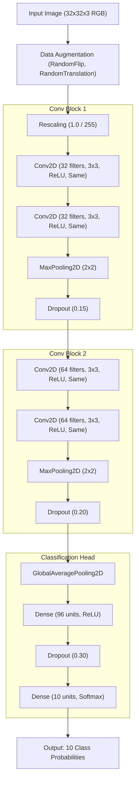

# 🧠 CIFAR-10 CNN Image Classifier & Streamlit Application

[](https://share.streamlit.io)
[](https://www.python.org/)
[](https://tensorflow.org/)
[](https://keras.io/)
[](LICENSE)

An end-to-end Machine Learning project delivering a **Convolutional Neural Network (CNN)** trained on the **CIFAR-10** dataset paired with a responsive, real-time **Streamlit web application** for interactive image classification.

---

## 📌 Table of Contents

- [Overview](#-overview)
- [Key Features](#-key-features)
- [Model Architecture & Training](#-model-architecture--training)
- [Live Deployment on Streamlit Cloud](#-live-deployment-on-streamlit-cloud)
- [Local Quickstart](#-local-quickstart)
- [Project Structure](#-project-structure)
- [Retraining & Evaluation](#-retraining--evaluation)
- [Assignment Deliverables](#-assignment-deliverables)
- [Author & Acknowledgments](#-author--acknowledgments)

---

## 🚀 Overview

This repository fulfills the **Minor Project Assignment (CNN Image Classification & Streamlit Application)**:
1. **Part A — CNN Model:** A compact deep convolutional neural network trained on CIFAR-10 (10 object categories) featuring data augmentation, dropout regularization, early stopping, and learning rate scheduling.
2. **Part B — Streamlit App:** An interactive browser interface that takes an uploaded photo or built-in sample images, feeds them through the trained model, and displays predicted classes with confidence distributions.

### Recognized Classes (CIFAR-10)

| ID | Class | Icon | ID | Class | Icon |
|:---:|:---|:---:|:---:|:---|:---:|
| **0** | Airplane | ✈️ | **5** | Dog | 🐶 |
| **1** | Automobile | 🚗 | **6** | Frog | 🐸 |
| **2** | Bird | 🐦 | **7** | Horse | 🐴 |
| **3** | Cat | 🐱 | **8** | Ship | 🚢 |
| **4** | Deer | 🦌 | **9** | Truck | 🚚 |

---

## ✨ Key Features

- **⚡ Instant Startup:** Comes pre-packaged with a trained model (`cifar10_cnn.keras`), eliminating wait time on cold starts.
- **🔄 Streamlit Resource Caching:** Uses `@st.cache_resource` for zero-latency inference across user sessions without reloading weights on reruns.
- **🖼️ Built-in Sample Selector:** Allows immediate one-click testing using embedded sample images (Frog, Bird, Ship, Cat) without requiring manual image downloads.
- **📊 Real-time Confidence Breakdown:** Displays both the winning prediction with confidence score and an interactive horizontal bar chart showing all 10 class probabilities.
- **🛡️ Safe Image Pipeline:** In-memory image processing with PIL and Base64 previews ensures no user uploads are permanently stored on disk.
- **☁️ Cloud & Container Ready:** Configured for one-click deployment on **Streamlit Community Cloud**, **GitHub Codespaces**, and VS Code Dev Containers (`.devcontainer`).

---

## 🏗️ Model Architecture & Training

The model is designed specifically for $32 \times 32 \times 3$ color images, striking an optimal balance between parameter efficiency and classification power:



### Training Pipeline Details
- **Optimizer:** Adam ($\alpha = 10^{-3}$)
- **Loss Function:** Sparse Categorical Crossentropy
- **Callbacks:**
  - `EarlyStopping` (monitors `val_loss`, patience = 3, restores best weights)
  - `ReduceLROnPlateau` (factor = 0.5, patience = 2, minimum lr = $10^{-5}$)
- **Dataset Partitioning:** Stratified 80% train / 10% validation / 10% test split preserving class balances.

---

## 🌐 Live Deployment on Streamlit Cloud

Deploying to **Streamlit Community Cloud** takes less than 2 minutes:

### 1-Click Setup Instructions

1. Go to **[share.streamlit.io](https://share.streamlit.io)** and log in with your GitHub account.
2. Click **"New app"**.
3. Fill in the repository configuration:
   - **Repository:** `DevvChaitan/CNN-Image-Classifier`
   - **Branch:** `main`
   - **Main file path:** `app.py` *(or `streamlit_app.py` / `CIFAR10_CNN_Streamlit_Project.py`)*
4. Under **Advanced settings** (optional):
   - **Python version:** Select `3.11` *(pre-configured via `.python-version`)*
5. Click **"Deploy!"** 🎉

> **Why this configuration works out of the box:**
> - `app.py` and `streamlit_app.py` are both registered as entry points.
> - `.python-version` locks Python 3.11 to guarantee compatibility with TensorFlow 2.15.
> - `.streamlit/config.toml` configures headless server execution, security headers, and styling.
> - `requirements.txt` strictly pins `numpy==1.26.4` to prevent NumPy 2.x ABI mismatches with TensorFlow.

---

## 💻 Local Quickstart

### Prerequisites
- Python 3.10 or 3.11 installed
- Git

### 1. Clone the repository
```bash
git clone https://github.com/DevvChaitan/CNN-Image-Classifier.git
cd CNN-Image-Classifier
```

### 2. Create and activate a virtual environment
```bash
# Windows
python -m venv .venv
.venv\Scripts\activate

# macOS / Linux
python3 -m venv .venv
source .venv/bin/activate
```

### 3. Install dependencies
```bash
pip install -r requirements.txt
```

### 4. Launch the Streamlit application
```bash
streamlit run app.py
```
*Your browser will automatically open at `http://localhost:8501`.*

---

## 📁 Project Structure

```text
CNN-Image-Classifier/
├── .devcontainer/
│   └── devcontainer.json           # VS Code & GitHub Codespaces dev container config
├── .streamlit/
│   └── config.toml                 # Streamlit server & theme configuration
├── sample_images/                  # Curated sample images for testing
│   ├── bird_sample.png
│   ├── cat_sample.png
│   ├── frog_sample.png
│   └── ship_sample.png
├── .gitattributes                  # LFS and binary file tracking rules
├── .gitignore                      # Clean ignore rules (cache, venv, temporary files)
├── .python-version                 # Pins Python 3.11 for Streamlit Cloud
├── app.py                          # Streamlit application entrypoint
├── streamlit_app.py                # Streamlit Cloud alternative entrypoint
├── CIFAR10_CNN_Streamlit_Project.py# Complete assignment script (Part A CNN + Part B App)
├── cifar10_cnn.keras               # Pre-trained CNN weights (Keras 2 / TF 2.15)
├── CIFAR10_CNN_Streamlit_Report.pdf# Academic project documentation & evaluation report
└── requirements.txt                # Production dependency specifications
```

---

## 🧪 Retraining & Evaluation

To train a fresh model from scratch and generate new evaluation curves:

```bash
python CIFAR10_CNN_Streamlit_Project.py --train --epochs 8
```

- If `train.7z` and `trainLabels.csv` are found in the working directory or parent folder, the script automatically extracts and trains on the Kaggle-format dataset.
- Otherwise, it seamlessly downloads the canonical CIFAR-10 dataset via `tf.keras.datasets.cifar10`.
- Outputs generated during training:
  - `training_curves.png` — Accuracy and loss across epochs
  - `model_summary.png` — Layer dimensions and parameter count
  - `prediction_examples.png` — Held-out test predictions with ground-truth comparisons
  - `metrics.json` — Quantified accuracy and loss metrics

---

## 📄 Assignment Deliverables

This project strictly adheres to the Minor Project submission specifications:
- **File 1 (Code):** `CIFAR10_CNN_Streamlit_Project.py` contains both **Part A (CNN)** and **Part B (Streamlit App)** in a single structured, commented Python file.
- **File 2 (Report):** [`CIFAR10_CNN_Streamlit_Report.pdf`](CIFAR10_CNN_Streamlit_Report.pdf) covers the complete methodology, dataset description, layer breakdown, training logs, evaluation figures, and conclusions.

---

## 👤 Author & Acknowledgments

- **Author:** Chaitanya Rao ([@DevvChaitan](https://github.com/DevvChaitan))
- **Course:** AIML Minor Project Assignment
- **Dataset:** CIFAR-10 by Alex Krizhevsky, Vinod Nair, and Geoffrey Hinton
